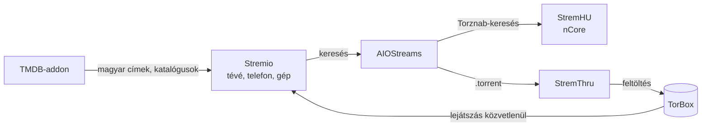

# StremHU + TorBox – saját szerver

Ez a repó egy kész, saját szerveren futó rendszer, amellyel a **Stremióban magyar torrenteket (nCore) nézhetsz a TorBox gyorsítótárán keresztül**. A filmek nem a szerverre töltődnek le: a szerver csak megkeresi a torrentet, átadja a TorBoxnak, a lejátszás pedig közvetlenül a TorBoxról megy.

> **Részletes dokumentáció:** [deploy/README.md](../deploy/README.md) – telepítés, beállítás, címek és jelszavak, a két kezelőpult, frissítés, hibaelhárítás.
>
> **Windowsos kezelőprogram:** [Szerverpult.exe letöltése](https://github.com/hubbert0/stremhu-source/releases/download/helyi-pult/Szerverpult.exe)

## Hogyan működik?

| Rész | Mit csinál | Honnan érhető el |
|---|---|---|
| **StremHU** | Keres az nCore-on, és kiadja a `.torrent` fájlt | nyilvános HTTPS-cím (Tailscale Funnel) |
| **AIOStreams** | Ezt adod hozzá a Stremióhoz; összegyűjti a találatokat és a TorBoxra küldi | nyilvános HTTPS-cím (Tailscale Funnel) |
| **StremThru** | Feltölti a `.torrent`-et a TorBoxra | csak belül, kívülről nem látszik |
| **TMDB-addon** | Magyar filmcímek, leírások, katalógusok a Stremióban | nyilvános HTTPS-cím (Tailscale Funnel) |
| **LeLibrary** | A TorBoxon lévő filmek és sorozatok poszterekkel a Stremio kezdőlapján, a sorozatrészek egymás után | nyilvános HTTPS-cím (Tailscale Funnel) |
| **Emby-könyvtár** | A saját otthoni Emby-szerverek filmjei és sorozatai a Stremio kezdőlapján, lejátszás közvetlenül az Embyről | nyilvános HTTPS-cím (Tailscale Funnel), titkos linkkel |
| **Magyar feliratok** | Felirataddon a feliratok.eu-hoz, javított ékezetekkel, a kiadáshoz illő sorrendben | nyilvános HTTPS-cím (Tailscale Funnel) |
| **Állapotfigyelő** | Gatus: mi működik, mi nem; hiba esetén értesítés a telefonra (ntfy) | csak a saját tailnetedről |
| **Mentés** | Backrest: titkosított napi mentés felhőtárhelyre | csak a saját tailnetedről |
| **Automatikus karbantartás** | Önjavító figyelő (3 percenként: ami nem válaszol, újraindítja) és heti automatikus frissítés, értesítéssel | a szerveren, ütemezve (cron) |
| **TorBox-helykezelés** | Figyeli a TorBox aktív helyeit (Pro: 10), és mindig hagy 2-t szabadon, a seedelési kötelezettséget betartva | a StremHU-n belül fut |
| **Szerverpult** | Böngészős kezelőfelület a szerveren: állapot, Docker, frissítés, széf, terminál | csak a saját tailnetedről |
| **Helyi Szerverpult** | Ugyanez Windows-programként a saját gépeden, SSH-n át; UltraVNC-indítással | csak a saját gépedről |

Minden rész Docker-konténerben fut, egyetlen paranccsal telepíthető és frissíthető.

## Mi ez a repó, és miért fork?

A [StremHU](https://github.com/s4pp1/stremhu-source) (szerző: s4pp1) önmagában nem tud TorBoxszal dolgozni. Peter Deme (peterdeme) írt hozzá egy kiegészítést, a [#283-as pull requestet](https://github.com/s4pp1/stremhu-source/pull/283), amelyen keresztül az AIOStreams lekérheti a `.torrent` fájlt. Ezt a hivatalos StremHU még nem vette át, ezért ez a repó egy **fork** (saját másolat), amely tartalmazza:

1. a hivatalos StremHU-t,
2. a #283-as kiegészítést,
3. a saját fejlesztéseket: TorBox-helykezelés, telepítőcsomag, a két kezelőpult.

A fork kapcsolatban marad az eredetivel, így a StremHU új verziói átvehetők. A repó nyilvános (GitHub-szabály: nyilvános projekt forkja nem lehet privát), de **nincs benne személyes adat** – a címek, jelszavak és kulcsok csak a szerveren (`.env`) és a saját gépeden vannak.

## Ágak

| Ág | Tartalom |
|---|---|
| `torbox` | **ez a használt változat** – minden saját fejlesztés itt van |
| `main` | a hivatalos StremHU változatlan másolata (frissítések átvételéhez) |

## A repó felépítése

| Mappa | Tartalom |
|---|---|
| `deploy/` | telepítőcsomag: `compose.yaml`, `install.sh`, `.env.example`, dokumentáció |
| `deploy/pult/` | a szerveren futó Szerverpult |
| `deploy/helyi-pult/` | a Windowsos Szerverpult (`Szerverpult.exe`) |
| `deploy/feliratok/` | a felirataddon (feliratok.eu) |
| `deploy/emby/` | az Emby-könyvtár bővítmény |
| `deploy/gatus/` | az állapotfigyelő beállításai |
| `deploy/scripts/` | az önjavító figyelő és a heti frissítés (cron-szkriptek) |
| `deploy/lelibrary/` | a LeLibrary magyarítása (a build előtt alkalmazott módosítás) |
| `server/app/modules/torbox_seed/` | a TorBox-helykezelés |
| `server/`, `client/` | a StremHU (szerver és webes felület) |
| `.github/workflows/` | automatikus tesztek és buildek |

## Automatikus buildek

A `torbox` ágra kerülő minden módosítás után a GitHub magától teszteli és elkészíti a programokat:

| Build | Eredmény |
|---|---|
| TorBox build (GHCR) | `ghcr.io/hubbert0/stremhu-source:torbox` – a StremHU Docker-image-e |
| Szerverpult build (GHCR) | `ghcr.io/hubbert0/stremhu-pult:latest` – a szerveres pult |
| Emby-könyvtár build (GHCR) | `ghcr.io/hubbert0/stremhu-emby:latest` – az Emby-könyvtár |
| Felirat-addon build (GHCR) | `ghcr.io/hubbert0/stremhu-feliratok:latest` – a felirataddon |
| LeLibrary (magyar) build (GHCR) | `ghcr.io/hubbert0/lelibrary-hu:latest` – a LeLibrary magyarított image-e |
| Helyi Szerverpult (Windows .exe) | [`Szerverpult.exe`](https://github.com/hubbert0/stremhu-source/releases/tag/helyi-pult) |

A szerver frissítéskor ezeket tölti le.

---

Az eredeti StremHU dokumentációja: [README.md](../README.md) és [stremhu.app](https://stremhu.app).
